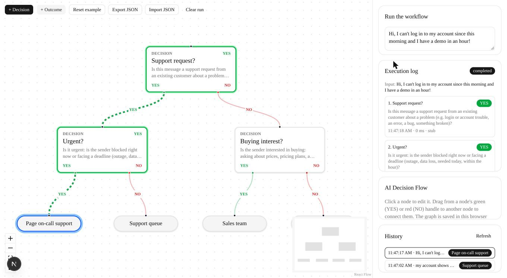

# AI Decision Flow

A visual workflow editor where every node is an AI decision that answers **YES** or **NO**.
The graph is drawn with [React Flow](https://reactflow.dev), executed step by step with
[Inngest](https://www.inngest.com), and each decision is made by an LLM through the OpenAI SDK
(pointed at any OpenAI-compatible provider).

```
"Is this a support request?"  --YES-->  Support
                              --NO--->  Sales
```

## Stack

Next.js 15 (App Router) · React Flow (`@xyflow/react`) · Inngest · OpenAI SDK · shadcn/ui · Tailwind

## Setup

```bash
npm install
cp .env.example .env.local      # add LLM_API_KEY, or set LLM_STUB=1 to run without a model
```

## Run (two terminals)

```bash
npm run dev        # Next.js on http://localhost:3000
npm run inngest    # Inngest dev server on http://localhost:8288 (discovers /api/inngest)
```

Open http://localhost:3000, type a message, press **Run**. The Inngest dashboard at
http://localhost:8288 shows each run and every node as its own step.



*(Screenshot taken in stub mode, `LLM_STUB=1`.)*

## How a run works

1. **Editor (React Flow).** Decision nodes hold a YES/NO question; each has a green **YES** and a
   red **NO** handle. Outcome nodes end a path. Connecting a handle again replaces that branch, so
   every decision has at most one YES and one NO edge. The graph is saved in `localStorage`.
2. **Start.** `POST /api/runs` validates `{ input, workflow }`, records the run and sends the
   Inngest event `workflow/run.requested` → `202 { runId }`.
3. **Execute (Inngest).** `src/inngest/functions.ts` finds the start node (the decision nothing
   points at), then walks the graph. **Each decision node is its own `step.run`**: it sends the
   node's question plus the input to the LLM, which must answer exactly `YES` or `NO`, and follows
   the matching edge until it reaches an outcome. The execution order, answers and the edges taken
   are recorded as it goes.
4. **Watch.** The UI polls `GET /api/runs/:id` and paints the canvas.

### The LLM step

`src/lib/llm.ts` sends a system prompt that allows only `YES` or `NO`, and the user's text as a
separate, JSON-encoded user message, so instructions inside the text are treated as data.
`temperature: 0`, `max_tokens: 5`, a 30 s timeout. The reply is parsed strictly: anything other than
`YES`/`NO` (after trimming quotes and punctuation) throws, and Inngest retries the step.
`LLM_STUB=1` swaps the model for a keyword rule, so you can build and demo without a key.

### Reliability

- A node that fails (timeout, provider error, a non YES/NO answer) is retried by Inngest
  (`retries: 2`). Steps that already finished are memoized, so a retry never re-asks earlier nodes.
- After the last retry, `onFailure` marks the run **failed** with the error, shown on the node and in
  the log. Tested by running with no LLM configured:
  `failed -> LLM_BASE_URL / LLM_MODEL are not set ...`.
- A run stops after 25 steps, so a graph with a cycle can't loop forever. A decision with no edge for
  its answer ends the run with "No YES path from ...".

## Polish (Phase 4)

| Feature | Where |
|---------|-------|
| Visual execution state — active node pulses, answered nodes turn green/red, the reached outcome turns blue, failed nodes red | `nodes.tsx`, `nodeStates()` |
| Animated active edges — the path taken is animated and thicker, the rest fade | `displayEdges` in `FlowEditor.tsx` |
| Execution logs panel — each step with question, answer, raw model reply, timing, errors | `ExecutionLog` |
| Execution history — recent runs, click one to replay it on the canvas | `RunHistory`, `GET /api/runs` |
| JSON export / import — download the graph, load it back (edges checked against nodes) | toolbar |
| Error handling + retry failed nodes | Inngest `retries` + `onFailure` |

## API

| Method | Route | |
|--------|-------|--|
| POST | `/api/runs` | `{ input, workflow }` → `202 { runId }`; 400 on bad input, 503 if Inngest is unreachable |
| GET | `/api/runs` | history, newest first |
| GET | `/api/runs/:id` | one run: status, steps, path, outcome, error |
| GET/POST/PUT | `/api/inngest` | Inngest serve endpoint |

## Project structure

```
src/app/page.tsx                 the editor page
src/components/flow/             FlowEditor, node views, run log + history
src/lib/graph.ts                 graph types, example workflow, local storage
src/lib/llm.ts                   YES/NO decision via the OpenAI SDK (+ stub)
src/lib/runs.ts                  run state (in memory - a real deployment would use a database)
src/inngest/                     Inngest client and the workflow function
src/app/api/                     run + Inngest endpoints
```

## Limitations

Run state lives in memory in the Next.js process (fine for the local dev setup, lost on restart);
production would store runs in a database and push updates over SSE instead of polling.
